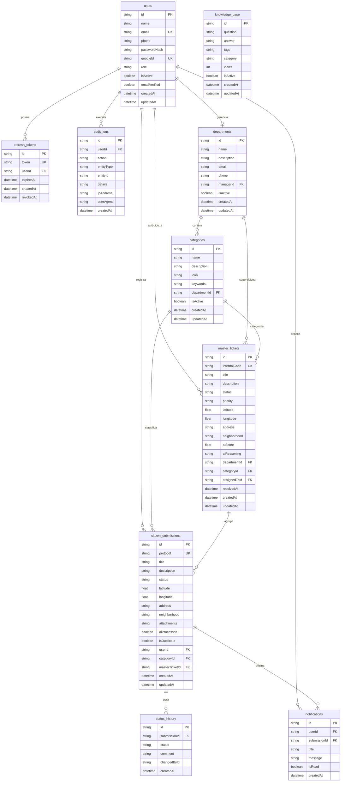

# 📊 Estrutura do Banco de Dados — Diagrama Relacional & DER (Modelo Entidade-Relacionamento)

Este documento contém o **Diagrama de Entidade e Relacionamento (DER)**, a **visualização em Mermaid** e o **Dicionário de Dados detalhado** das tabelas do banco de dados relacional da **Plataforma de Ouvidoria Municipal Inteligente**.

---

## 📐 1. Diagrama Entidade-Relacionamento (DER / Mermaid)

---

## 🗃️ 2. Visualização das Tabelas & Dicionário de Dados

### 👤 2.1 Tabela `users` (Usuários & Autenticação)
Armazena cidadãos, atendentes, gestores de secretarias e administradores gerais.

| Campo | Tipo | Chave | Nulo? | Padrão | Descrição |
|---|---|---|---|---|---|
| `id` | String (UUID) | **PK** | Não | `uuid()` | Identificador único do usuário |
| `name` | String | | Não | | Nome completo |
| `email` | String | **UK** | Não | | E-mail do usuário (Login) |
| `phone` | String | | Sim | `null` | Telefone / WhatsApp de contato |
| `passwordHash` | String | | Sim | `null` | Hash da senha (bcrypt) ou `null` se via Google OAuth |
| `googleId` | String | **UK** | Sim | `null` | Subject ID do Google OAuth 2.0 |
| `role` | String | | Não | `"CITIZEN"` | Papel: `CITIZEN`, `ATTENDANT`, `SECTOR_MANAGER`, `SUPER_ADMIN` |
| `isActive` | Boolean | | Não | `true` | Status da conta de usuário |
| `emailVerified` | Boolean | | Não | `false` | Se o e-mail foi verificado |
| `createdAt` | DateTime | | Não | `now()` | Data de cadastro |
| `updatedAt` | DateTime | | Não | Auto | Última atualização |

---

### 🔑 2.2 Tabela `refresh_tokens` (Sessões & JWT Refresh)
Armazena tokens de renovação para sessões seguras.

| Campo | Tipo | Chave | Nulo? | Padrão | Descrição |
|---|---|---|---|---|---|
| `id` | String (UUID) | **PK** | Não | `uuid()` | Identificador do token |
| `token` | String | **UK** | Não | | Token de refresh gerado (cryptographic token) |
| `userId` | String (UUID) | **FK** | Não | | ID do usuário proprietário (`users.id`) |
| `expiresAt` | DateTime | | Não | | Data de expiração do refresh token |
| `createdAt` | DateTime | | Não | `now()` | Data de criação |
| `revokedAt` | DateTime | | Sim | `null` | Data em que foi revogado/invalidado |

---

### 🏛️ 2.3 Tabela `departments` (Secretarias Municipais)
Representa as Secretarias Públicas e Órgãos Responsáveis.

| Campo | Tipo | Chave | Nulo? | Padrão | Descrição |
|---|---|---|---|---|---|
| `id` | String (UUID) | **PK** | Não | `uuid()` | Identificador da secretaria |
| `name` | String | | Não | | Nome da Secretaria (ex: Obras, Iluminação, Saúde) |
| `description` | String | | Sim | `null` | Atribuições e escopo do departamento |
| `email` | String | | Sim | `null` | E-mail oficial da secretaria |
| `phone` | String | | Sim | `null` | Telefone de atendimento interno |
| `managerId` | String (UUID) | **FK, UK** | Sim | `null` | ID do gestor responsável (`users.id`) |
| `isActive` | Boolean | | Não | `true` | Ativo ou inativo |
| `createdAt` | DateTime | | Não | `now()` | Data de criação |
| `updatedAt` | DateTime | | Não | Auto | Última atualização |

---

### 🏷️ 2.4 Tabela `categories` (Categorias de Manutenção / Serviços)
Tipos de serviços ou ocorrências associados às Secretarias.

| Campo | Tipo | Chave | Nulo? | Padrão | Descrição |
|---|---|---|---|---|---|
| `id` | String (UUID) | **PK** | Não | | Identificador da categoria (ex: `cat-buraco`) |
| `name` | String | | Não | | Nome amigável (ex: "Buraco / Cratera na Via") |
| `description` | String | | Sim | `null` | Descrição detalhada da categoria |
| `icon` | String | | Sim | `null` | Emoji ou ícone representativo |
| `keywords` | String | | Não | | Palavras-chave para IA e busca (separadas por vírgula) |
| `departmentId` | String (UUID) | **FK** | Não | | Secretaria responsável (`departments.id`) |
| `isActive` | Boolean | | Não | `true` | Status |
| `createdAt` | DateTime | | Não | `now()` | Data de criação |
| `updatedAt` | DateTime | | Não | Auto | Última atualização |

---

### 🤖 2.5 Tabela `master_tickets` (Demandas Agrupadas por IA)
Agrupa chamados repetidos do mesmo problema ou bairro para atendimento coletivo pela prefeitura.

| Campo | Tipo | Chave | Nulo? | Padrão | Descrição |
|---|---|---|---|---|---|
| `id` | String (UUID) | **PK** | Não | `uuid()` | Identificador da demanda agrupada |
| `internalCode` | String | **UK** | Não | | Código único interno (ex: `MT-2026-0001`) |
| `title` | String | | Não | | Título resumido da ocorrência coletiva |
| `description` | String | | Não | | Resumo inteligente sintético gerado por IA |
| `status` | String | | Não | `"TRIAGED"` | Status: `TRIAGED`, `IN_PROGRESS`, `COMPLETED`, etc. |
| `priority` | String | | Não | `"MEDIUM"` | Prioridade: `LOW`, `MEDIUM`, `HIGH`, `CRITICAL` |
| `latitude` | Float | | Sim | `null` | Latitude média do agrupamento |
| `longitude` | Float | | Sim | `null` | Longitude média do agrupamento |
| `address` | String | | Sim | `null` | Endereço ou ponto de concentração |
| `neighborhood` | String | | Sim | `null` | Bairro principal afetado |
| `aiScore` | Float | | Sim | `null` | Grau de confiança do agrupamento por IA (0.0 a 1.0) |
| `aiReasoning` | String | | Sim | `null` | Justificativa técnica do modelo de IA |
| `departmentId` | String (UUID) | **FK** | Não | | Secretaria responsável (`departments.id`) |
| `categoryId` | String (UUID) | **FK** | Não | | Categoria atribuída (`categories.id`) |
| `assignedToId` | String (UUID) | **FK** | Sim | `null` | Servidor/atendente atribuído (`users.id`) |
| `resolvedAt` | DateTime | | Sim | `null` | Data e hora de conclusão |
| `createdAt` | DateTime | | Não | `now()` | Data de criação |
| `updatedAt` | DateTime | | Não | Auto | Última atualização |

---

### 📝 2.6 Tabela `citizen_submissions` (Demandas & Manifestações dos Cidadãos)
Registro principal das solicitações, denúncias, reclamações, sugestões e elogios.

| Campo | Tipo | Chave | Nulo? | Padrão | Descrição |
|---|---|---|---|---|---|
| `id` | String (UUID) | **PK** | Não | `uuid()` | Identificador da solicitação |
| `protocol` | String | **UK** | Não | | Protocolo público de rastreio (ex: `OUV-2026-000123`) |
| `title` | String | | Não | | Título/Assunto da manifestação |
| `description` | String | | Não | | Relato detalhado do cidadão (ou gravação transcrita) |
| `status` | String | | Não | `"RECEIVED"` | Status: `RECEIVED`, `TRIAGED`, `FORWARDED`, `IN_PROGRESS`, `COMPLETED`, `REJECTED` |
| `latitude` | Float | | Sim | `null` | Latitude de geolocalização (opcional) |
| `longitude` | Float | | Sim | `null` | Longitude de geolocalização (opcional) |
| `address` | String | | Sim | `null` | Endereço e rua informados |
| `neighborhood` | String | | Sim | `null` | Bairro |
| `attachments` | String | | Sim | `null` | URLs/Caminhos das mídias anexadas (JSON/String) |
| `aiProcessed` | Boolean | | Não | `false` | Se a demanda foi analisada pela IA |
| `isDuplicate` | Boolean | | Não | `false` | Se foi marcada como duplicata/agrupada |
| `userId` | String (UUID) | **FK** | Não | | ID do cidadão solicitante (`users.id`) |
| `categoryId` | String (UUID) | **FK** | Sim | `null` | Categoria classificada (`categories.id`) |
| `masterTicketId` | String (UUID) | **FK** | Sim | `null` | ID do agrupamento mestre (`master_tickets.id`) |
| `createdAt` | DateTime | | Não | `now()` | Data de abertura |
| `updatedAt` | DateTime | | Não | Auto | Última atualização |

---

### 📜 2.7 Tabela `status_history` (Histórico de Tramitação / Auditoria de Status)
Registra cada alteração de status e parecer técnico de uma demanda.

| Campo | Tipo | Chave | Nulo? | Padrão | Descrição |
|---|---|---|---|---|---|
| `id` | String (UUID) | **PK** | Não | `uuid()` | ID do histórico |
| `submissionId` | String (UUID) | **FK** | Não | | ID da solicitação (`citizen_submissions.id`) |
| `status` | String | | Não | | Status atribuído |
| `comment` | String | | Sim | `null` | Parecer / Justificativa pública ou interna |
| `changedById` | String (UUID) | | Sim | `null` | ID do operador que alterou o status |
| `createdAt` | DateTime | | Não | `now()` | Data da alteração |

---

### 🔔 2.8 Tabela `notifications` (Notificações ao Cidadão)
Notificações enviadas aos cidadãos sobre andamento e respostas dos chamados.

| Campo | Tipo | Chave | Nulo? | Padrão | Descrição |
|---|---|---|---|---|---|
| `id` | String (UUID) | **PK** | Não | `uuid()` | ID da notificação |
| `userId` | String (UUID) | **FK** | Não | | Destinatário (`users.id`) |
| `submissionId` | String (UUID) | **FK** | Sim | `null` | Solicitação relacionada (`citizen_submissions.id`) |
| `title` | String | | Não | | Título da notificação |
| `message` | String | | Não | | Conteúdo do aviso |
| `isRead` | Boolean | | Não | `false` | Status de leitura |
| `createdAt` | DateTime | | Não | `now()` | Data de envio |

---

### 🛡️ 2.9 Tabela `audit_logs` (Logs de Auditoria & Conformidade LGPD)
Registra todas as ações administrativas, alterações de usuários e modificações no sistema.

| Campo | Tipo | Chave | Nulo? | Padrão | Descrição |
|---|---|---|---|---|---|
| `id` | String (UUID) | **PK** | Não | `uuid()` | ID do log |
| `userId` | String (UUID) | **FK** | Sim | `null` | ID do operador (`users.id`) |
| `action` | String | | Não | | Ação executada (ex: `USER_UPDATED`, `STATUS_CHANGED`) |
| `entityType` | String | | Sim | `null` | Entidade afetada (`User`, `CitizenSubmission`, etc.) |
| `entityId` | String | | Sim | `null` | ID da entidade afetada |
| `details` | String | | Sim | `null` | Detalhes em formato JSON |
| `ipAddress` | String | | Sim | `null` | Endereço IP do cliente |
| `userAgent` | String | | Sim | `null` | Navegador / Dispositivo |
| `createdAt` | DateTime | | Não | `now()` | Data do registro |

---

### 📚 2.10 Tabela `knowledge_base` (Base de Conhecimento / FAQ da Ouvidoria)
Artigos informativos e respostas frequentes para a população e auxílio à IA.

| Campo | Tipo | Chave | Nulo? | Padrão | Descrição |
|---|---|---|---|---|---|
| `id` | String (UUID) | **PK** | Não | `uuid()` | ID do artigo |
| `question` | String | | Não | | Pergunta ou tópico |
| `answer` | String | | Não | | Resposta oficial da Ouvidoria |
| `tags` | String | | Não | | Palavras-chave de busca (separadas por vírgula) |
| `category` | String | | Sim | `null` | Categoria temática |
| `views` | Int | | Não | `0` | Contador de visualizações |
| `isActive` | Boolean | | Não | `true` | Ativo ou inativo |
| `createdAt` | DateTime | | Não | `now()` | Data de criação |
| `updatedAt` | DateTime | | Não | Auto | Última atualização |

---

## 🔄 3. Regras de Integridade e Relacionamentos

1. **Agrupamento Inteligente (MasterTickets x Submissions):**
   - Uma `MasterTicket` pode agrupar **1 ou mais `CitizenSubmission`**.
   - Cada `CitizenSubmission` possui um ponteiro opcional `masterTicketId`. Quando a IA identifica duplicidade ou similaridade na mesma área, preenche o `masterTicketId` e marca `isDuplicate = true`.
2. **Ciclo de Atendimento (Secretarias x Categorias x Demandas):**
   - Cada `Department` possui **várias `Category`**.
   - Toda `CitizenSubmission` é associada a uma `Category` (que pertence a um `Department`).
3. **Segurança e Rastreabilidade (Users x AuditLogs x RefreshTokens):**
   - `RefreshTokens` possuem deleção em cascata (`onDelete: Cascade`) vinculada ao `User`.
   - `AuditLogs` mantêm o registro de auditoria imutável mesmo se o usuário for modificado.
